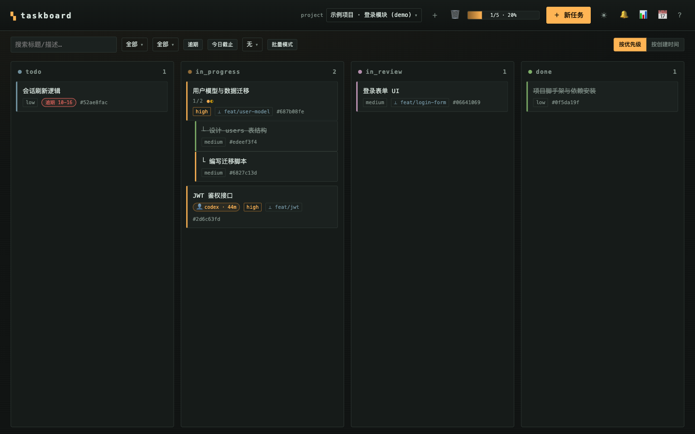
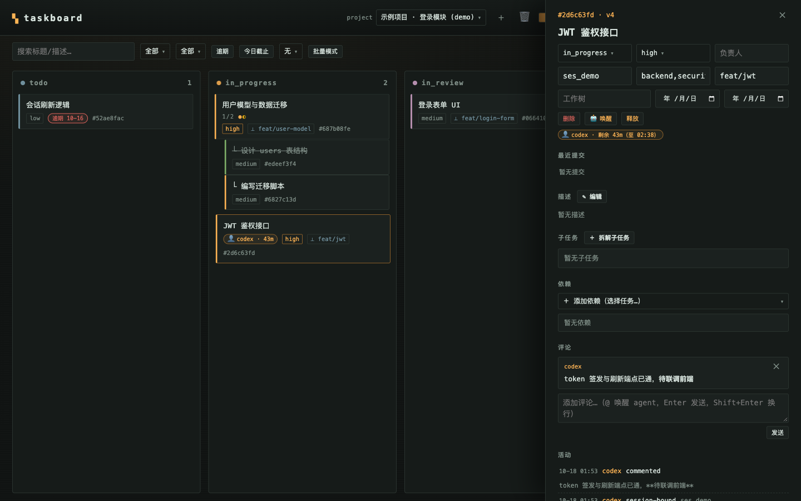
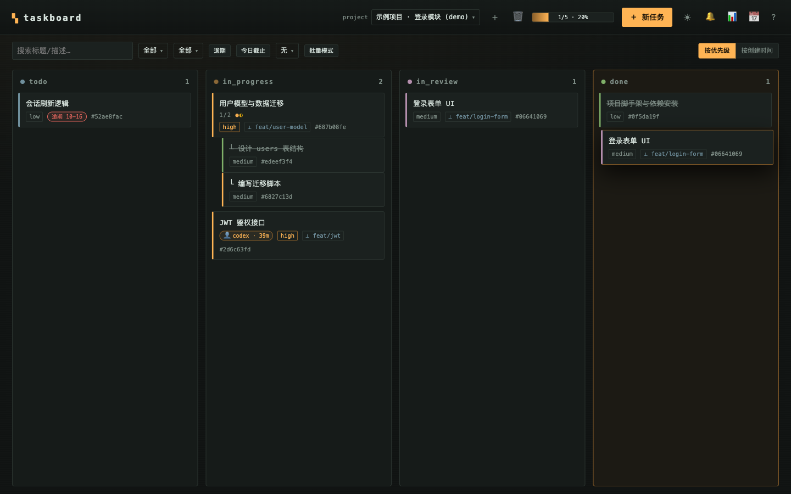
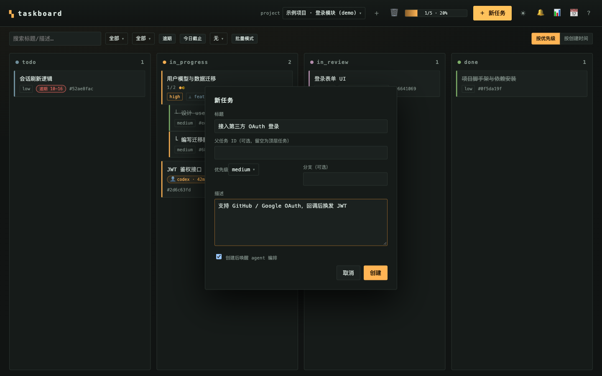
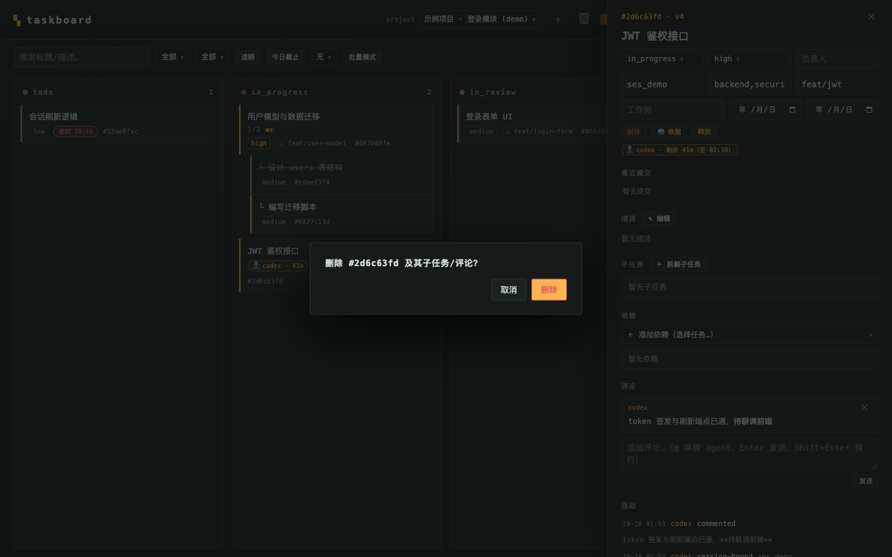
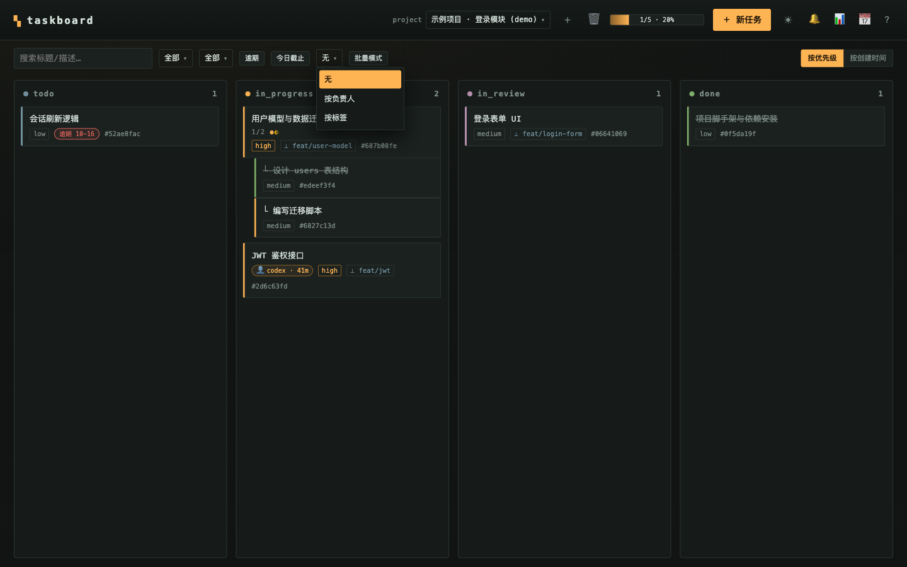
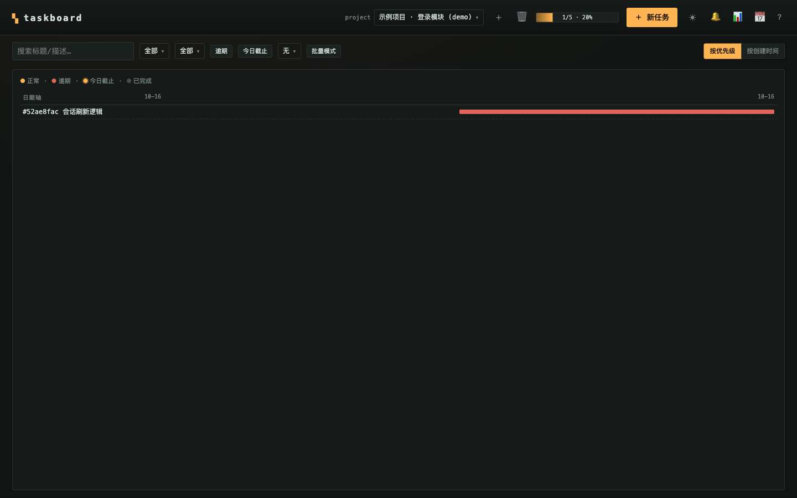
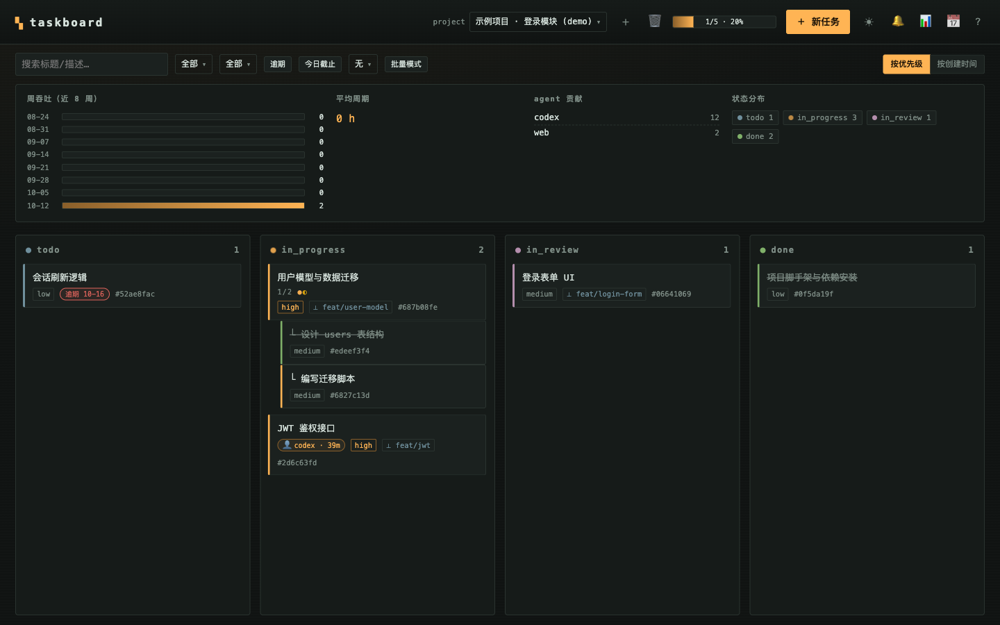
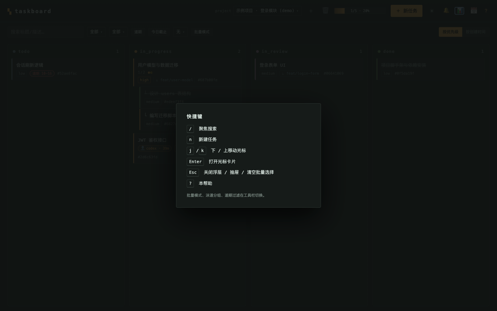

# open-taskboard

本地优先（local-first）的任务看板，为 [opencode](https://opencode.ai) 及任何 agent 工具设计——看任务、拆解任务、跟踪任务。灵感来自 [dashi-taskboard](https://github.com/chuspeeism/dashi-taskboard)（Codex 版），无需 CDP 注入。

**v0.3 起采用 pnpm monorepo：** `packages/core`（领域层，类型三端共享）+ `server`（Fastify）+ `cli` + `mcp` + `apps/web`（Vite + React）。SQLite 用 Node 22.5+ 内置 `node:sqlite`，无原生编译依赖。

## 架构

```
apps/
├── server/   @taskboard/server Fastify：REST + SSE + 静态托管看板（可部署应用）
├── web/      @taskboard/web    Vite + React 看板（可部署应用）
├── cli/      @taskboard/cli    taskboard 命令行（bin: taskboard，依赖 server 的 startServer）
└── mcp/      @taskboard/mcp    MCP server（bin: taskboard-mcp）
packages/
└── core/     @taskboard/core   类型 + Store（node:sqlite），server/cli/mcp/web 共享
skills/       opencode skill（工作流纪律）
```

划分约定与 Nx 等一致：`apps/` = 可部署应用（server、web、cli、mcp 四个入口），`packages/` = 共享库（core）。

```
Web 看板 ─┐
CLI      ─┼─→ Fastify 服务（node:sqlite + SSE，唯一权威）
MCP server ─┘   ↑ 各 agent 工具各自拉起一个 MCP 进程连这里
```

## 快速开始

```bash
pnpm install      # 需要 pnpm 9+（npm i -g pnpm）；一键安装依赖并自动构建全部包
pnpm build        # 手动重新构建：core → server/cli/mcp + web
pnpm clean        # 一键删除依赖：移除根目录及各子包的 node_modules
pnpm start        # http://127.0.0.1:47824

# 开发模式（先构建 core，再并行起 server watch + vite 热更新）
pnpm dev          # API :47824, Vite :5174

# CLI（开发期）
pnpm cli -- project create --id my-project --name "My project"
# 或构建后
node apps/cli/dist/cli.js issue list --project my-project
```

常用命令（`taskboard`，构建后可 `pnpm --filter @taskboard/cli link` 全局可用）：

```bash
taskboard project create --id my-project --name "My project"
taskboard issue create --project my-project --title "搭建登录模块" --priority high --branch feat/login
taskboard issue create --project my-project --parent <父任务ID> --title "登录表单 UI"
taskboard issue done <id> --expected-version 2
taskboard next --project my-project          # 智能取任务：依赖全 done + 优先级排序
taskboard issue claim <id> --agent codex     # 独占租约（默认 30 分钟，taskboard ready --agent 可跳过他人租约）
taskboard search "登录"                       # 全文搜索（标题/描述/评论）
taskboard stats --project my-project         # 统计面板（周吞吐/平均周期/贡献榜）
taskboard progress --project my-project
taskboard project delete skill-test --yes
```


## 5 分钟上手（人类视角）

1. `pnpm install && pnpm start` → 浏览器打开 `http://127.0.0.1:47824`
2. 面板上「＋项目」建第一个项目（空态页也有一键示例项目）
3. 「＋ 新任务」建任务——勾选「创建后唤醒 agent 编排」可直接召唤 AI 接手
4. 拖卡片流转状态；拖**父任务**时会询问是否整组移动（子任务跟随）
5. 点卡片开抽屉：改状态/负责人/分支/会话绑定、拆子任务、排依赖、传附件、写评论（输入 @ 唤醒 agent）

## 任务流转与协作规则（人话版）

```
todo → in_progress → in_review → done
```

- **认领即开工**：AI `claim` 一个 todo 任务，状态自动变「进行中」，并把任务绑定到它的会话——卡片上的 👤 徽章告诉你谁在做
- **验收在你手里**：AI 做完只会到「待验收」（in_review）；done 由你在面板点，AI 想跳过验收会被服务器直接拒绝（403 门禁，默认开启）
- **子任务开工，父任务自动亮起**：任一子任务开工，父任务自动从待办进入进行中（单向；父任务的验收与关闭永远人工）
- **删除都有二次确认**：小操作（评论/依赖边）原位两步确认，大操作（任务/批量）应用内弹窗，整个项目要手输 id
- **每个 AI 干活都留痕**：活动流记录谁在何时做了什么；乐观锁保证多 AI 并发互不覆盖

## 面板一览与功能速览

**看板主视图**（暗色终端风，四列流转，各列独立滚动，顶栏/工具栏常驻）：



**任务抽屉**（全字段编辑、子任务、依赖、评论、附件、活动流一屏全览）：



**拖拽流转**（跨列拖拽带浮层预览，拖父任务可整组移动）：



<details>
<summary><strong>更多界面截图</strong>（新建任务 / 确认弹窗 / 自定义下拉 / 时间线 / 统计 / 快捷键）</summary>

新建任务——勾选「创建后唤醒 agent 编排」可直接召唤 AI 接手：



删除等危险操作走应用内确认弹窗（带焦点陷阱与 ESC）：



全站下拉均为自绘 listbox（键盘 ↑↓/Enter/Esc 可导航）：



时间线视图 📅（甘特 lite）：



统计面板 📊（周吞吐/平均周期/贡献榜）：



快捷键帮助（`?` 呼出）：



</details>

## 面板功能速览

- 拖拽流转、批量模式、泳道分组（按负责人/标签）、逾期与今日截止过滤
- 时间线视图 📅（甘特 lite）、统计面板 📊（周吞吐/平均周期/贡献榜）
- 快捷键：`/` 搜索 · `n` 新建 · `j/k` 上下移动 · `Enter` 打开 · `?` 全部帮助
- 附件上传下载（每任务 ≤20 个/总量 ≤50MB）、桌面通知、暗/亮主题
- 任务绑定 opencode 会话（抽屉里填 `ses_…`）→ 面板唤醒直达该会话上下文

## 评论唤醒 agent（watch 侧车）

不打开 TUI 也能派活：`taskboard watch` 常驻订阅看板事件，`@agent` 开头的评论按通道优先级唤醒 AI：

```bash
taskboard watch --tui-url http://127.0.0.1:4096   # ① 指令进你 TUI 输入框（推荐：同会话全上下文，人工回车提交）
taskboard watch --opencode http://127.0.0.1:4096  # ② 注入任务绑定的会话（需 opencode 新版支持）
taskboard watch                                    # ③ headless 兜底（--exec/--model 可配，全新会话）
taskboard watch --project my-project               # 只唤醒该项目的 @agent（多实例分项目路由）
```

- 触发两种：任务下评论 `@agent <指令>`，或新建任务时勾选「创建后唤醒 agent 编排」
- `--on` 可自定义唤醒前缀；通道失败自动降级（①→②→③）
- **多终端隔离**：`opencode serve` 的 TUI 注入是广播语义——多个终端 `attach` 同一端口时，一处注入每只输入框都会收到。多终端各管各项目时，给每个 `opencode serve --port N` 配一个独立 watch（不同的 `--tui-url` + `--project`），日志也各自独立
- 常驻部署：任何进程管理器均可（macOS launchd / systemd / pm2），启动命令就是上面一行；同一 watch（同 server/tui/项目通道）由 pid-lock 单实例保护（`~/.taskboard/watch-<server>-<tui>-<project>.lock`），重复实例不会双注入

## 接入 agent 工具

> **🤖 给 AI 的自包含接入手册：[docs/AI-INTEGRATION.md](docs/AI-INTEGRATION.md)** —— 连接方式、5 步核心工作流、硬规则表、唤醒协议、错误处理。AI 读完该文档即可正确接入，无需其他上下文。

REST API 的完整契约（OpenAPI 3.1）在服务启动后可从 `/api/openapi.json` 获取。

### 方式一：MCP（推荐，Claude Code / Codex / Cursor / opencode 通用）

MCP server 无状态转发到本地 HTTP 服务，服务未运行时自动拉起。工具：

- 项目：`list_projects` `create_project` `delete_project`
- 任务：`list_issues` `show_issue` `create_issue` `update_issue`（乐观锁 version 必填）`delete_issue` `archive_issue` `unarchive_issue`
- 租约：`claim_issue` `heartbeat_issue` `release_issue`（独占租约，默认 30 分钟，过期后他人可直接认领）
- 协作：`add_comment` `add_issue_dependency` `remove_issue_dependency` `list_attachments`
- 视图：`progress` `project_stats` `ready_issues` `next_issue` `search_issues`

```jsonc
// Claude Code (.mcp.json) / Cursor (~/.cursor/mcp.json)
{ "mcpServers": { "taskboard": { "command": "node", "args": ["/abs/path/open-taskboard/apps/mcp/dist/mcp.js"] } } }
```

```toml
# Codex (~/.codex/config.toml)
[mcp_servers.taskboard]
command = "node"
args = ["/abs/path/open-taskboard/apps/mcp/dist/mcp.js"]
```

```json
// opencode (~/.config/opencode/opencode.json)
{ "mcp": { "taskboard": { "type": "local", "command": ["node", "/abs/path/open-taskboard/apps/mcp/dist/mcp.js"] } } }
```

建议同时在 AGENTS.md / rules 中加入：

> 管理任务时使用 taskboard MCP 工具；状态流转 todo → in_progress → in_review → done，**不流转不许开工**（服务端 claim 会把 todo 自动置为 in_progress，认领即开工），done 必须等用户确认；update_issue 必须携带 show_issue 返回的 version（乐观锁）；拆解需求时先建父任务再用 parentId 建子任务；多 agent 并发先 claim 再开工，长任务定期 heartbeat 续租，完成即 release；agent 创建任务带 sessionId，认领未绑定任务用 claim sessionId 绑定自己的会话（只绑空位，不抢绑）。

### 方式二：Skill + CLI（opencode 或不支持 MCP 的工具）

```bash
ln -s /abs/path/open-taskboard/skills/open-taskboard ~/.config/opencode/skill/open-taskboard
```

## 环境变量

| 变量 | 默认 | 说明 |
|---|---|---|
| `TASKBOARD_HOST` | `127.0.0.1` | HTTP 绑定地址（LAN 共享改 `0.0.0.0`） |
| `TASKBOARD_PORT` | `47824` | HTTP 端口 |
| `TASKBOARD_DATA_DIR` | `.data` | SQLite 数据目录 |
| `TASKBOARD_URL` | `http://127.0.0.1:47824` | CLI / MCP 指向的服务地址 |
| `TASKBOARD_WEB_DIST` | 自动探测 | 看板静态目录（默认 `apps/web/dist`，vite 构建产物） |
| `TASKBOARD_TOKEN` | 未设置 | 设置后 API 需要 Bearer 认证（`Authorization: Bearer <token>` 或 `?token=`；SSE 支持 `?token=`） |
| `TASKBOARD_READONLY` | 未设置 | `1` 时所有写操作（POST/PATCH/DELETE）返回 403，GET/SSE 不受影响 |
| `TASKBOARD_WEBHOOK_URL` | 未设置 | 逗号分隔的 HTTP(S) URL；设置后每个事件（project/issue/comment 变更）以 POST JSON 转发到各 URL（3s 超时，失败重试一次，失败仅告警） |
| `TASKBOARD_WEBHOOK_SECRET` | 未设置 | 设置后 webhook 请求带 `X-Taskboard-Signature: sha256=HMAC-SHA256(body, secret)`，接收端应对原始字节验签后再解析 |
| `TASKBOARD_HUMAN_DONE` | 默认开启 | `done` 门禁：agent 来源置 `done`（PATCH 与 create 皆含）返回 403，除非用户确认后 agent 传 `confirm: true` 代为设置；web 来源（人工 UI）不受影响。纯自动化看板设 `0` 显式关闭 |
| `TASKBOARD_BACKUPS` | 未设置 | `0` 关闭启动备份；默认每次启动 `VACUUM INTO` 快照到 `<dataDir>/backups/`，保留最近 10 份 |

## 功能

- 父子两层任务拆解、四列状态流转（todo → in_progress → in_review → done）；子任务开工自动把 `todo` 父任务拉到 `in_progress`（单向），父任务 `in_review`/`done` 始终人工
- 乐观锁版本（`version` / `--expected-version` / MCP `update_issue` 必填）防并发覆盖
- 独占租约：claim / heartbeat / release，多 agent 并发防碰撞；`next`/`ready` 自动跳过他人租约中的任务
- 依赖阻塞：blocked-by 边 + 循环检测 + 同项目约束；`ready`/`next` 只返回依赖全 done 的任务
- 进度统计：一个顶层任务 = 一个单位（自身 done 或子任务全 done 即完成，父任务等权）
- 评论、活动流、标签、负责人、分支/worktree 绑定、起止日期（校验真实日历）、归档（归档父任务连带其未归档子任务）
- 全文搜索（FTS5 trigram，标题/描述/评论，短查询退化 LIKE）、导出/导入 JSON（taskboard export/import）、统计面板（周吞吐/平均周期/贡献榜）、时间线视图、Mermaid 图渲染
- 附件（元数据入库、正文落盘 `attachments/`，单文件 ≤10MB，每任务限额 20 个/总量 50MB 超限 400）、桌面通知、暗/亮主题、泳道分组、批量操作、j/k 键盘导航
- 评论唤醒 agent：`taskboard watch` 常驻订阅 SSE，`@agent` 开头的评论按通道优先级唤醒——TUI 注入（`--tui-url` 指向 opencode serve，指令文本进入附着的 TUI 输入框，人工回车提交，同会话全上下文）→ 绑定会话 v2 prompt 注入（`--opencode`）→ headless spawn（`--exec`/`--model` 兜底，全新会话）；`--on` 可改唤醒前缀；`--project` 按项目路由（多 watch 实例分项目隔离，断线重连自动补拉窗口内漏掉的 `@agent` 评论且与实时流对称去重）
- SSE 实时刷新（Web 多端 + 跨 agent 工具共享同一块板；25s 心跳保活，断线指数退避重连 + 全量兜底拉取）
- LAN 共享（`TASKBOARD_HOST=0.0.0.0`）、Bearer 令牌认证、只读模式、人工 done 门禁、webhook 事件转发
